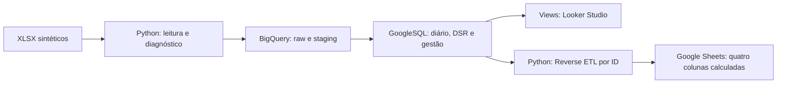

# Absenteísmo e impacto em folha

Pipeline em Python e GoogleSQL para transformar registros de ponto em indicadores de ausência, estimativas de desconto e recomendações de gestão. Analisa **junho a agosto de 2025**, com quatro planilhas sintéticas fornecidas para o desafio.

**Entregas:** [Dashboard no Looker Studio](https://datastudio.google.com/reporting/7bdfde4c-c915-4549-ad2d-d13e40f32b2f) · [Planilha de gestão atualizada](https://docs.google.com/spreadsheets/d/1L4JSPWAaKSKgAFMyALhtBc5jEEzK32q0Vwna4B-hlYs/edit)

O pipeline foi executado no BigQuery e no Google Sheets. As quatro páginas do dashboard foram montadas; o usuário confirmou o acesso em janela anônima em 30/10/2026.

## Resultados

| Indicador | Resultado |
| --- | ---: |
| Colaboradores na gestão | 40 |
| Faltas integrais / ausências parciais injustificadas | 25 / 105 |
| Horas injustificadas / abonadas | 247,7 / 42 |
| DSRs perdidos confirmados | 27 |
| Desconto conhecido, parcial | R$ 7.087,90 |
| Datas pendentes / motivos sobrepostos | 288 / 301 |
| Colaboradores atualizados / retidos para revisão | 32 / 8 |

O desconto é um **subtotal conhecido**: existem parcelas sem salário confiável e descansos iniciais que dependem de dados de maio. Pendências permanecem explícitas, sem virar faltas ou descontos zero. Veja [as regras](docs/regras-de-negocio.md) e [a validação dos resultados](docs/validacao.md).

A atualização escreveu 128 células calculadas e preservou o histórico manual dos gestores. A reexecução retornou `NO_CHANGES`, sem nova escrita ou alteração da data de processamento.

## Executar localmente

Pré-requisitos: Python 3.12 ou superior e [uv](https://docs.astral.sh/uv/getting-started/installation/). Na raiz do projeto:

```bash
uv sync --locked
uv run demarco diagnose
uv run pytest -q
```

O diagnóstico lê os XLSX de `data/raw/` e gera JSONL e relatórios em `artifacts/diagnostico/`. Não precisa de conta Google, não altera as entradas e mantém arquivo, aba, linha e tipos de origem. As versões das dependências estão fixadas em `uv.lock`.

Para reproduzir a carga, os modelos e a atualização da gestão, siga [o guia de execução](docs/execucao.md). Ele inclui configuração do `.env`, credenciais próprias, importação do template, permissões e todos os comandos em ordem. Carga, transformações e verificações SQL geram planos locais por padrão; `--execute` aplica no serviço. `bq-status` testa a conexão real. A prévia de `sheets-sync` consulta as fontes sem escrever.

## Arquitetura



As tabelas `raw_*` preservam os dados recebidos; `stg_*` normalizam tipos, removem duplicatas exatas e corrigem a codificação identificada. Os modelos seguintes mantêm ausências confirmadas, pendências e rastreabilidade separadas. Todas as consultas e scripts utilizados estão incluídos, também os de auditoria e preparação do ambiente.

## Estrutura

```text
.
├── data/raw/       # Quatro XLSX sintéticos originais
├── src/demarco/    # CLI, ingestão, diagnóstico, BigQuery e integração Sheets
├── sql/            # Transformações, funções compartilhadas e verificações
├── dashboard/      # Contrato de fontes, fórmulas, páginas e tema
├── scripts/        # Utilitários de acesso, reprodução e apoio visual
├── tests/          # Testes locais, sem rede ou credenciais
├── docs/           # Execução, regras, Reverse ETL, dashboard e validação
└── artifacts/      # Resultados e backups locais, ignorados pelo Git
```

## Documentação

- [Execução: instalação, configuração e pipeline completo](docs/execucao.md)
- [Regras de negócio: tratamento, modelo, DSR e recomendações](docs/regras-de-negocio.md)
- [Reverse ETL: escrita restrita e preservação do histórico](docs/reverse-etl.md)
- [Dashboard: fontes, páginas, fórmulas e filtros](docs/dashboard.md)
- [Validação: resultados, verificações e acesso da banca](docs/validacao.md)

## Verificação do código

```bash
uv run pytest -q
uv run ruff check .
uv run ruff format --check .
```

Os testes cobrem contratos de entrada, duplicatas, conflitos, conversões, preparação SQL e a API Sheets simulada, incluindo reordenação, concorrência e preservação de campos manuais. As regras também possuem verificações executadas no BigQuery real. [Detalhes da validação](docs/validacao.md).

## Arquivos públicos

As quatro planilhas sintéticas fazem parte da reprodução. O enunciado original `Desafio_Demarco.md`, os PNGs, `.env`, credenciais, dados processados e backups estão excluídos pelo `.gitignore`. Fórmulas copiáveis, links de criação e referências visuais são gerados em `artifacts/`, mantendo o repositório concentrado em fontes e documentação.
